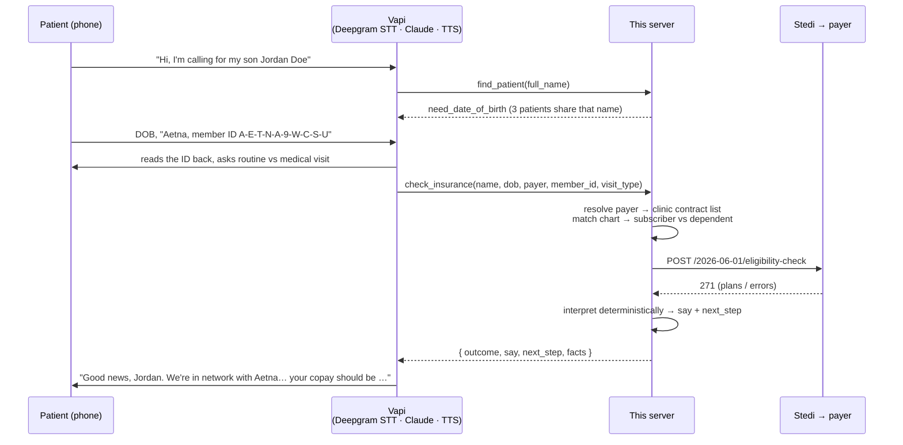

# Insurance verification voice agent

A phone line for an ophthalmology practice near campus. A patient calls, says who they are,
reads their insurance card, and hears, in plain English, whether we take their insurance and
what their copay will be. Every answer comes from a live 270/271 eligibility check through
[Stedi](https://www.stedi.com/), and every spoken number can be traced back to a field in the
payer's response.

**Stack:** Node 22 · TypeScript · Yarn · Express · [Vapi](https://vapi.ai) (telephony, speech, Claude Haiku 5.5) · Stedi (sandbox) · Render

## How a call works



## The design decision that matters: the model never decides anything

"100% accuracy" isn't achievable if a language model is choosing which copay to read out of a
40-entry benefits response. So the work is split:

| Layer | Owns | Can it be wrong in a way the caller hears? |
|---|---|---|
| **Claude (in Vapi)** | Conversation: asking one question at a time, reading member IDs back, tone, off-topic and emergency handling | Only in phrasing. It's instructed to say the tool's `say` text and never state a number that isn't in a tool result. |
| **`src/eligibility/interpret.ts`** | Reading the 271: active/inactive, plan dates, HMO, Medicare, dental-only, the visit copay, coinsurance, deductible | Unit-tested, deterministic, and it refuses to guess (see below). |
| **`src/eligibility/script.ts`** | The exact sentence for each outcome and what to do next | Reviewed copy, like any other UI text. |
| **`src/payers.ts`** | Whether *we* accept the plan | Clinic config: the 271 can't tell you if a provider is in network ([Stedi docs](https://www.stedi.com/docs/healthcare/eligibility-network-status-authorization-referrals)). |

### "Accepted" = clinic contract × active coverage

Eligibility isn't acceptance. A Kaiser member with active coverage still isn't covered here.
The agent answers *accepted* only when the payer is on the clinic's contract list **and**
the payer reports active coverage for today's date.

### Which copay? Ophthalmologists are specialists

Payers return many copays: PCP, specialist, urgent care, ER, telehealth, in and out of network.
`pickVisitCopay` takes in-network, per-person, office-setting copays, drops anything that isn't
an office visit (ER, telehealth, labs…), then walks tiers: **specialist office visit (STC 98) →
unlabeled office visit → plan-level (STC 30)**. It never uses a primary-care-only copay. If the
winning tier holds two different amounts, it **reports both and offers a callback** instead of
picking one. A wrong copay costs the clinic more than "let me confirm that for you."

## Every preset patient, every state

The Stedi sandbox only answers for its fixed mock patients, so the clinic chart
(`src/data/patients.ts`) mirrors them, and they cover the states a real front desk sees:

| Situation | How the agent handles it |
|---|---|
| Active, in network | Copay in dollars; HMO referral and prior-auth notes when the payer says so |
| Student / child / spouse on someone else's plan | Sent as a dependent under the policyholder automatically when the card matches the chart |
| Medicare | No copay: explains 20% coinsurance after the Part B deductible, mentions supplements |
| Out of network (Kaiser, Ambetter) | Confirms coverage is active, explains we're out of network, offers self-pay price and a callback |
| Inactive coverage | Says so plainly, asks for a newer card, offers self-pay or a callback |
| Reads us a dental card | Recognizes dental-only plans and asks for the medical card |
| Payer down (AAA 42) | Retries once automatically, then a callback. Never guesses |
| Wrong member ID / name / not found (AAA 72, 73, 75) | Asks once to re-read the card or for the policyholder, then a callback |
| Our setup rejected (AAA 43, 79) | Tells the caller it's not their fault, files a callback |
| 10+ patients named Jane/John Doe | Narrows by date of birth, then by the card itself (two Jane Does share a birthday) |
| Speech-to-text says "Arroyo" for "Arrojo" | Fuzzy surname match, then confirms the chart spelling |
| Eye emergency mentioned | Sends them to 911 / ER instead of checking insurance |

## Run it

```bash
corepack yarn install
cp .env.example .env          # add STEDI_API_KEY (test mode) and VAPI_API_KEY
yarn test                     # unit tests (no network)
yarn eval                     # every preset patient against the live Stedi sandbox
yarn dev                      # server on :3000, dashboard at /?token=$DASHBOARD_TOKEN
```

Deploy: push to GitHub, then in Render **New → Blueprint** with this repo (`render.yaml`). Fill in
`STEDI_API_KEY` and `VAPI_API_KEY`, then point Vapi at it:

```bash
PUBLIC_BASE_URL=https://<your-service>.onrender.com yarn vapi:sync
yarn eval:calls               # scripted end-to-end conversations through Vapi's chat API
```

`vapi:sync` creates or updates the assistant from `src/vapi/assistant.ts` (prompt, tools, voice,
transcriber) and attaches a free Vapi phone number, so the agent is versioned in git.

## Repo map

```
src/
  index.ts                 Express app: Vapi webhook, dashboard, demo API
  vapi/assistant.ts        System prompt + tool schemas + voice config (source of truth)
  vapi/webhook.ts          Vapi server messages: tool-calls, status, end-of-call report
  vapi/tools.ts            find_patient · check_insurance · request_callback
  eligibility/service.ts   Patient → payer → subscriber/dependent → Stedi → answer
  eligibility/interpret.ts 271 → facts (deterministic)
  eligibility/script.ts    facts → what the caller hears
  stedi/client.ts          Timeouts, one retry for AAA 42 / 5xx
  payers.ts                Clinic contracts + spoken payer aliases
  patients.ts              Progressive patient matching
  normalize.ts             Speech → member IDs, dates, names
  dashboard.ts             Staff view: live calls, callback queue, scenario runner
scripts/                   vapi-sync, eval (Stedi), eval-conversations (Vapi chat)
test/                      Vitest
```

## What production needs next

- **Identity:** verify name + DOB (and caller ID) before discussing PHI; the brief waived it for v1.
- **HIPAA:** BAAs with Vapi (HIPAA mode: no stored recordings or transcripts), Stedi, the LLM provider, and Render. Move the call log from memory to an encrypted database.
- **Patient data:** read the chart and insurance on file from the practice-management system (ModMed / Nextech) instead of `patients.ts`.
- **Richer checks:** request STC 98 (office visit) and AL (vision) alongside 30. The sandbox only supports 30. Add vision carriers (VSP, EyeMed) for routine exams, and MBI lookup for Medicare patients who don't have their card.
- **Network status:** per-plan contract table (payers have different networks per product), or payer FHIR provider directories.
- **Ops:** real transfer to the front desk (`FRONT_DESK_NUMBER`), callback queue in the EHR task list, alerting on AAA 43/79 (those are our bugs, not the patient's).
